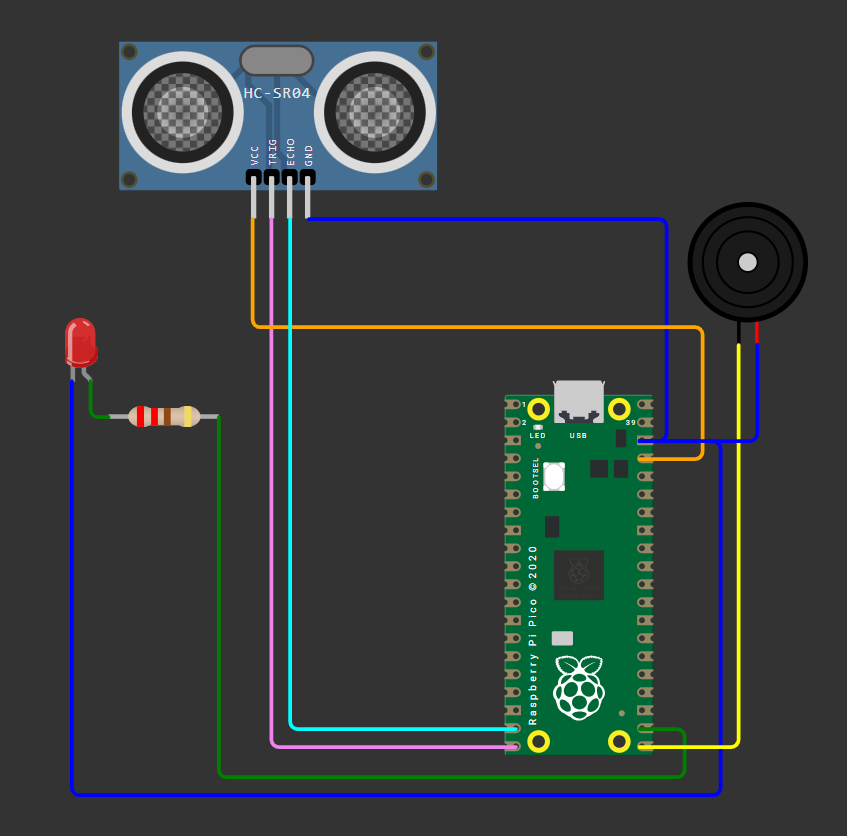
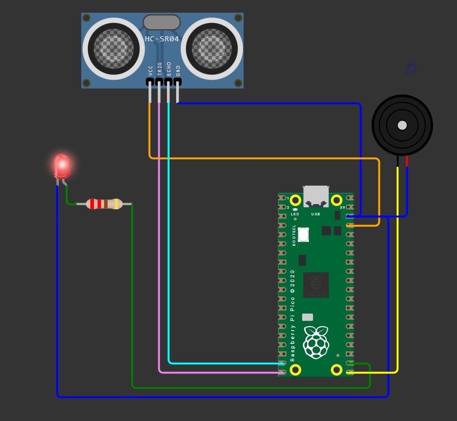

# 🦯 Bengala Inteligente – CitizenTech para Acessibilidade Urbana

> **FIAP – Global Solution (GS 2026.2)**  
> **Disciplina:** Computer Organization and Architecture  
> **Docente:** Prof. Dr. Marcus Grilo  
> **Tema:** CitizenTech (Tecnologia Cidadã) – Physical Computing: IoT & IoB  

---

## 👥 Identificação dos Integrantes

| Nome Completo | RM |
| :--- | :--- |
| ENZO SEIJI DELGADO TABUCHI | 573156 |
| LUCA ALMEIDA LUCARELI | 569061 |
| HENRIQUE ALMEIDA LUCARELI | 569183 |

---

## 🔗 Links de Entrega

* 🌐 **Simulação no Wokwi:** [Clique aqui para acessar o projeto no Wokwi](https://wokwi.com/projects/480152768068327425)
* 🎥 **Vídeo Demonstrativo (YouTube):** [Clique aqui para assistir à apresentação no YouTube](INSERIR_LINK_DO_YOUTUBE_AQUI)

---

## 📌 Sumário
1. [Etapa 1 – Identificação e Compreensão do Problema](#-etapa-1--identificação-e-compreensão-do-problema)
2. [Etapa 2 – Planejamento da Solução e Arquitetura](#-etapa-2--planejamento-da-solução-e-arquitetura)
3. [Etapa 3 – Construção do Protótipo e Hardware](#-etapa-3--construção-do-protótipo-e-hardware)
4. [Etapa 4 – Demonstração e Como Executar](#-etapa-4--demonstração-e-como-executar)
5. [📁 Estrutura de Arquivos do Projeto](#-estrutura-de-arquivos-do-projeto)
6. [📋 Critérios de Avaliação Atendidos](#-critérios-de-avaliação-atendidos)

---

## 🏙️ Etapa 1 – Identificação e Compreensão do Problema

### 1.1 O Problema no Cotidiano Urbano
No planejamento urbano atual, as calçadas e vias públicas apresentam diversos obstáculos que comprometem o direito fundamental de ir e vir com segurança. Embora as bengalas longas tradicionais sejam instrumentos essenciais para a locomoção de deficientes visuais, elas possuem uma limitação crítica: **detectam exclusivamente obstáculos situados ao nível do solo**.

Elementos suspensos ou aéreos, tais como:
* Orelhões telefônicos e caixas de correio / armários de rede;
* Lixeiras suspensas, grades e toldos baixos;
* Galhos de árvores não podados em vias públicas;
* Caçambas de entulho e retrovisores de veículos estacionados irregularmente sobre calçadas.

Esses objetos estão fora do raio de varredura da ponta da bengala no chão, resultando em acidentes frequentes, contusões na cabeça e no tronco, além de insegurança psicológica que restringe a mobilidade autônoma.

### 1.2 Público Afetado
* **Pessoas com deficiência visual severa ou cegueira total:** Usuários que dependem de instrumentos táteis para navegação.
* **Pessoas com baixa visão e idosos:** Cidadãos com percepção de profundidade comprometida ou campo de visão reduzido.
* **Comunidade urbana em geral:** Familiares, acompanhantes e a sociedade, que ganham com espaços públicos mais inclusivos e seguros.

### 1.3 Justificativa CitizenTech (Tecnologia Cidadã)
O conceito de **CitizenTech** baseia-se no uso da tecnologia e da computação física para resolver desafios sociais reais e promover inclusão e qualidade de vida. Através da Internet das Coisas (IoT) e de microcontroladores de baixo custo (como a **Raspberry Pi Pico**), é viável transformar um dispositivo mecânico passivo (a bengala tradicional) em um **equipamento inteligente e proativo**, democratizando a tecnologia assistiva de forma acessível e escalável.

---

## 🧠 Etapa 2 – Planejamento da Solução e Arquitetura

### 2.1 Descrição da Solução
A **Bengala Inteligente** é um sistema embarcado que realiza o escaneamento frontal contínuo do ambiente. Através de pulsos ultrassônicos, o sistema calcula a distância de aproximação de obstáculos e notifica o usuário em tempo hábil através de **estímulos multissensoriais dinâmicos**:
1. **Feedback Sonoro (Buzzer com Modulação PWM):** A frequência de bipes acelera conforme a proximidade do perigo, fornecendo percepção intuitiva de distância.
2. **Feedback Visual (LED Vermelho de Alto Brilho):** Alerta pedestres e ciclistas ao redor de que o usuário está próximo a um obstáculo, auxiliando também usuários com audição reduzida.

### 2.2 Fluxo de Dados e Processamento (Computação Física)
O microcontrolador RP2040 (Raspberry Pi Pico) atua como o núcleo do processamento:

```
[ Sensor HC-SR04 ]  ---> Pulso Echo (Tempo) --->  [ Raspberry Pi Pico ]
                                                         |
                                                (Filtro de Média Móvel)
                                                         |
                                                (Classificação por Zonas)
                                                         |
                                       +-----------------+-----------------+
                                       |                                   |
                                       v                                   v
                             [ Buzzer Piezoelétrico ]            [ LED Indicador ]
                               (PWM Dinâmico/Bipes)              (Aviso de Alerta)
```

1. **Entrada de Dados:** Disparo de pulso de trigger (10µs) e medição da duração do sinal de eco em microssegundos (`utime.ticks_us()`).
2. **Processamento Matemático & Filtragem:**
   * Cálculo da distância em centímetros: $\text{Distância (cm)} = \frac{\Delta t \times 0.0343}{2}$
   * Aplicação de **Filtro de Média Móvel** (FIFO de 3 amostras) para eliminar flutuações e ruídos espúrios de reflexão sonora.
3. **Máquina de Estados de Alerta:** Avaliação contra limiares pré-configurados e atualização de saídas.

### 2.3 Diferenciais de Engenharia de Software Embarcado
* **Orientação a Objetos (POO):** O código foi modularizado em classes (`SensorUltrassonico` e `SistemaAlerta`), garantindo manutenibilidade, coesão e encapsulamento de hardware.
* **Arquitetura Reativa e Não-Bloqueante:** Em vez de utilizar instruções bloqueantes como `time.sleep()`, o sistema utiliza `utime.ticks_ms()` e cálculo de diferença de tempo (`utime.ticks_diff()`). Isso permite que a leitura do sensor permaneça fluida e ininterrupta mesmo durante a geração de bipes.
* **Bipe Proporcional Dinâmico:** Na zona de atenção, o intervalo do bipe é diretamente proporcional à distância ($\text{intervalo} \approx \text{distância} \times 3\text{ ms}$), variando de bipes compassados a bipes rápidos e contínuos.

---

## 🔌 Etapa 3 – Construção do Protótipo e Hardware

### 3.1 Lista de Componentes

| Item | Componente | Função no Sistema |
| :---: | :--- | :--- |
| **1** | **Raspberry Pi Pico** | Microcontrolador central (Dual-core ARM Cortex-M0+ RP2040) |
| **2** | **Sensor Ultrassônico HC-SR04** | Medição da distância frontal (Entrada sensorial) |
| **3** | **Buzzer Piezoelétrico** | Transdutor acústico para alertas por bipes e frequência sonora (Saída) |
| **4** | **LED Difuso Vermelho 5mm** | Sinalização visual complementar de proximidade (Saída) |
| **5** | **Resistor de 220 Ω** | Limitador de corrente para proteção da porta GPIO e do LED |

### 3.2 Pinout e Tabela de Conexões

| Componente | Terminal / Pino | Pino Raspberry Pi Pico | GPIO | Função / Sinal |
| :--- | :--- | :--- | :--- | :--- |
| **HC-SR04** | VCC | Pino 36 | 3V3(OUT) | Alimentação 3.3V |
| | GND | Pino 38 | GND | Referência de Terra |
| | TRIG | Pino 20 | **GP15** | Pulso de Gatilho (Saída Digital) |
| | ECHO | Pino 19 | **GP14** | Leitura de Pulso de Eco (Entrada Digital) |
| **Buzzer** | Ânodo (+) | Pino 21 | **GP16** | Saída Modulada por Largura de Pulso (PWM) |
| | Cátodo (-) | Pino 23 | GND | Referência de Terra |
| **LED** | Ânodo (+) | Terminal 1 do Resistor 220Ω | - | Conectado em série ao resistor |
| **Resistor** | Terminal 2 | Pino 22 | **GP17** | Saída Digital de Controle |
| **LED** | Cátodo (-) | Barramento GND | GND | Referência de Terra |

### 3.3 Zonas de Alerta e Regras de Negócio

| Faixa de Distância | Classificação | Comportamento do Buzzer | Comportamento do LED | Significado Operacional |
| :---: | :---: | :---: | :---: | :--- |
| **> 150 cm** | 🟢 **Zona Segura** | Desligado (Silêncio) | Apagado | Caminho desobstruído |
| **50 cm a 150 cm** | 🟡 **Zona de Atenção** | Bipes intermitentes (Frequência: 500 Hz); intervalo acelera com a aproximação | Pisca sincronizado com o som | Obstáculo detectado a média distância |
| **< 50 cm** | 🔴 **Zona de Perigo** | Tom contínuo de alta frequência (1000 Hz) | Aceso contínuo | Risco iminente de colisão; parada recomendada |

### 3.4 Capturas da Simulação no Wokwi

| Estado Desativado / Zona Segura (> 150 cm) | Estado Ativo / Zona de Alerta e Perigo (< 150 cm) |
| :---: | :---: |
|  |  |
| *Circuito em repouso: LED apagado e buzzer em silêncio.* | *Circuito ativado: detecção em tempo real com disparo de atuadores.* |

---

## 🎮 Etapa 4 – Demonstração e Como Executar

### 4.1 Execução Online via Wokwi
1. Abra o link do projeto no [Wokwi](https://wokwi.com/projects/480152768068327425).
2. Clique no botão de reprodução verde (**Start the simulation / Play ▶️**).
3. Observe o console serial do MicroPython exibindo a inicialização do sistema.
4. Clique sobre o sensor ultrassônico **HC-SR04** para abrir o slider interativo de distância.
5. Movimente o slider para testar os cenários:
   * Acima de 150 cm: Sistema em repouso.
   * Entre 150 cm e 50 cm: Bipes e piscadas intermitentes graduais.
   * Abaixo de 50 cm: Alerta sonoro contínuo e LED travado em nível alto.

### 4.2 Execução Local (VS Code com Wokwi Simulator)
Caso deseje rodar localmente no VS Code:
1. Instale a extensão **Wokwi Simulator** no Visual Studio Code.
2. Certifique-se de manter os arquivos `diagram.json` e `main.py` na raiz do projeto.
3. Pressione `F1` e selecione `Wokwi: Start Simulator`.

### 4.3 Roteiro Sugerido para o Vídeo de Demonstração
Conforme os critérios de avaliação da atividade, o vídeo deve conter:
- [x] **Abertura:** Apresentação de todos os integrantes do grupo e contextualização do projeto.
- [x] **Problema & Justificativa:** Explicação da vulnerabilidade dos deficientes visuais a obstáculos suspensos.
- [x] **Hardware & Circuito:** Explicação dos pinos da Raspberry Pi Pico, sensor ultrassônico e atuadores.
- [x] **Demonstração Prática:** Demonstração da simulação Wokwi em funcionamento, variando os dados de entrada no slider do HC-SR04 e comprovando a mudança correspondente nas saídas (som e luz).
- [x] **Conclusão:** Benefícios gerados para a sociedade e cidadania (CitizenTech).

---

## 📁 Estrutura de Arquivos do Projeto

A organização dos arquivos segue as melhores práticas para projetos de sistemas embarcados e repositórios acadêmicos:

```plaintext
gs-computer-organization-architecture/
├── diagram.json                 # Arquivo de esquemático e conexões nativo do Wokwi
├── main.py                      # Código-fonte principal em Python (MicroPython)
├── README.md                    # Documentação técnica completa da atividade
└── docs/
    └── images/
        ├── simulacao-alerta-ativo.png       # Screenshot do protótipo em estado de alerta
        └── simulacao-alerta-desativado.png  # Screenshot do protótipo em estado seguro
```